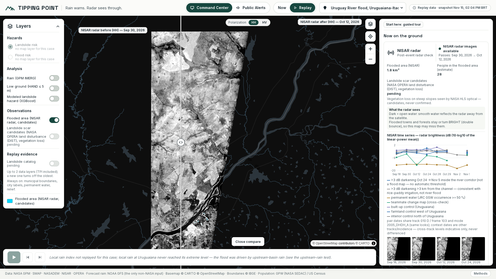
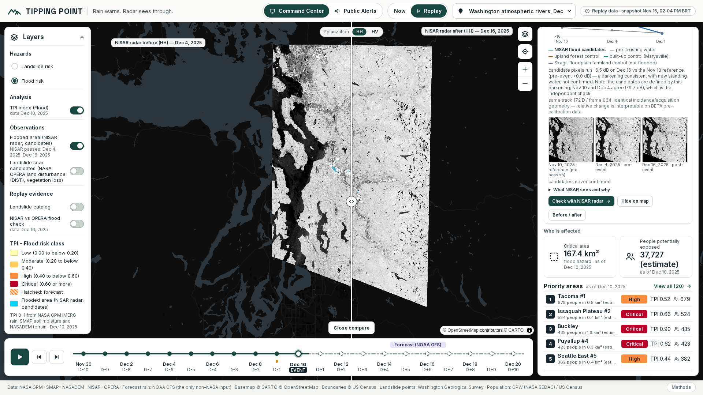
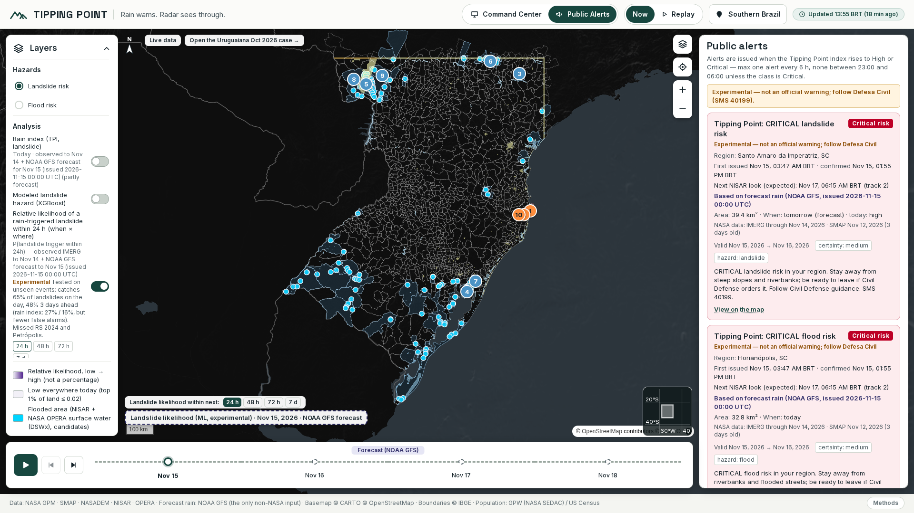

# tipping-point-app

Fullstack app for **Tipping Point** — NASA Space Apps Challenge 2026,
"Dancing with the SARs". Rain warns. Radar sees through.

**Live demo:** [https://tippingpoint.l17s.dev](https://tippingpoint.l17s.dev) · **Data pipeline:** [r2l2pj/tipping-point-data](https://github.com/r2l2pj/tipping-point-data) · **License:** Apache-2.0 · **Team:** [TEAM NAME] — NASA Space Apps 2026, challenge #5 "Dancing with the SARs"

## What it is

Tipping Point helps responders know **when, where and who** in floods and landslides: NASA rain (GPM IMERG), soil moisture (SMAP) and terrain (NASADEM) show where risk is rising, and NISAR's L-band radar sees through cloud to where the ground newly flooded. Our main case is at home: the **Uruguay River at Uruguaiana** (Rio Grande do Sul, Brazil). In October 2026 the Uruguay River at Uruguaiana stayed above its 8.50 m flood stage on Oct 5–21 (ANA gauge). Replayed with the data as it was available, our index, fed by NASA satellite rain, turned the Uruguaiana region Critical on Sep 30, five days before flood stage, and NOAA's GFS forecast from Sep 27 already pointed there, 8 days ahead (near-real-time rain; it holds when scaled to the final product; 3 small false alarms on Sep 20–22). It found the right days, not yet the right streets; NISAR passes every 12 days then saw the water through cloud, and about 98,000 people live on the low floodplain. Two past disasters back it up: Washington State, December 2025 (NISAR flood candidates under 92.9% cloud) and Rio Grande do Sul, May 2024 (a replay with each forecast as it was issued). The river will still flood; what we aim to prevent is the disaster. **Rain warns. Radar sees through.**

| Uruguaiana, Oct 2026 — NISAR before / during the flood | Washington, Dec 2025 — NISAR before / after | Live public alerts (experimental) |
|---|---|---|
|  |  |  |

## How it works

- **Radar response (NISAR, L-band):** new open water = HH backscatter drop of more than 3 dB to below a per-scene threshold, on low ground near rivers (height above drainage < 15 m), patches ≥ 3 ha. Outputs are always **flood candidates**. NASA OPERA surface water (DSWx) adds C-band water candidates; NASA OPERA land disturbance (DIST) adds landslide **scar candidates** (optical).
- **Where to look between passes:** the Tipping Point Index TPI = (R·S·T)^(1/3) — Rain (GPM IMERG 3-day vs each pixel's own climatology), Soil (SMAP L4 root-zone wetness), Terrain (NASADEM slope; height above drainage for floods). Critical (> 0.6) only when all three agree. The next 1–3 days use the **NOAA GFS** forecast, our only non-NASA input, labelled on every frame.
- **Who:** GPW v4.11 population count (2020) inside the flood candidates and the Critical areas; VIIRS Black Marble night-light loss.
- **ML (experimental):** an XGBoost landslide-trigger model sits beside the index. An independent audit found it about as good as a simple forecast-rain-vs-local-extreme rule; see [07-overfit-audit](https://github.com/r2l2pj/tipping-point-data/blob/main/docs/science-review/07-overfit-audit.md).
- **Live:** the Now view refreshes every 3 hours over Southern Brazil; replays use only the data and forecast available on each day (no look-ahead).

## Honest results

Full table with every n and caveat: [Validation](#validation).

| Check | Result | Caveat |
|---|---|---|
| Washington: NISAR flood candidates | 27.99 km² within the swath, about 950 people inside | post pass covers 74% of the area; BETA products |
| Washington: NISAR vs NASA OPERA surface water (C-band), new flood | F1 0.15 (precision 0.19, recall 0.13) | reference is a model, not ground truth; double bounce explains the misses: 45% of the missed flood is in towns or forest vs 5% of what we caught |
| Rio Grande do Sul 2024: landslides, forecast as issued | 5.8% of 16,027 mapped landslides were High or Critical in the forecast issued 27 h before the first deaths, while that forecast flagged 2.1% of the area: 2.7× chance | runs issued 51 and 75 h before: 0%; one run carries it |
| Forecast lead (replays, horizon 0–3 days) | about 1 day in Rio Grande do Sul (the run 27 h before the first deaths); none for Washington's flooded places (0% at 24/48/72 h) | local-rain index; official warnings came first in both replays |
| Forecast alarms by municipality | Rio Grande do Sul 1.4× chance, Washington 2.0× | landslide maps undated |
| Uruguaiana 2026 (replay) | Critical over the Uruguaiana region on Sep 30 (13,129 km², 6,121 on the low floodplain), 5 days before flood stage; the NOAA GFS run of Sep 27 already showed Critical on the floodplain for Sep 29–30 (8 days ahead); 54% of the NISAR flood candidates (a teammate's polygons) lie on the floodplain, which is 28% of the land (1.92×); about 98,000 people on the floodplain | near-real-time rain, holds scaled to the final product (3,541 km² on the floodplain); 15 Critical days Sep 15–Oct 31, 3 small ones (Sep 20–22) with no flood stage within 10 d; Critical area only 1.34× concentrated on the floodplain; numbers depend on the case box; our stricter automatic NISAR check did not reproduce the teammate polygons |
| ML trigger model | median per-event ROC 0.93 over 9 held-out disasters | about as good as a simple rule; ~4–5 alarm-days per site per year; experimental |

## Repo map

| Path | What |
|---|---|
| `src/app/` | Next.js routes: `/` (Command Center: Now + Replay), `/alerts` (public alerts), `api/` |
| `src/components/command/` | the Command Center UI (map, right-panel tabs, replay, NISAR swipe) |
| `src/lib/` | data contract + loaders (reads the data repo's published files) |
| `scripts/sync-data.mjs` | copies `../tipping-point-data/data` into `public/data` (bundled last-resort fallback) |
| `docs/` | `PLAN.md` (the team's plan), `app-contract.md`, deploy notes, screenshots |
| `submission/` | Space Apps submission texts (project page, form, script) |

Data products are produced by [tipping-point-data](https://github.com/r2l2pj/tipping-point-data) (`data/SCHEMA.md` is the contract) and read at runtime from its GitHub `fallback` branch (raw files), with the bundled copy as the last resort.

## Credits and attributions

NASA data: GPM IMERG, SMAP L4, NASADEM, NISAR (GCOV, provisional/BETA), NASA OPERA DSWx and DIST-ALERT, HLS, VIIRS Black Marble, SWOT, GPW v4.11 (SEDAC), Global Landslide Catalog / COOLR. Forecast rain: NOAA GFS 0.25°. Required attributions: NASA OPERA DSWx-S1 contains modified Copernicus Sentinel-1 data (ESA); Copernicus Emergency Management Service EMSR720 © European Union (independent validation maps); Washington Geological Survey landslide inventory; UFRGS/Cemaden landslide inventory; IBGE boundaries; basemap © CARTO, © OpenStreetMap contributors. River levels: ANA (Brazil) telemetry.

## Technical notes


Next.js 16 (App Router) + MapLibre + `@google/earthengine`. Serves the artifacts
published by [`r2l2pj/tipping-point-data`](https://github.com/r2l2pj/tipping-point-data).
Earth Engine is not on the runtime path — it is used only for one-off compute and
hosted copies; live EE layers stay off by default, opt-in via `GEE_ENABLED`
(`1`/`true`).

## Run

```bash
bun install
bun run dev                   # predev syncs ../tipping-point-data/data -> public/data
bun run build && bun run start  # production build + server (how the demo is served)
```

At runtime the server reads live data from the data repo's GitHub `fallback`
branch first; `public/data` is only the last-resort fallback.

`DATA_REPO=/path/to/tipping-point-data` overrides the sibling-repo default.

## Use of AI

Built with AI coding assistants (Anthropic Claude via Claude Code, Cognition
Devin, OpenAI Codex/GPT) under human direction: they wrote and reviewed code
and drafted docs. The idea, method and data choices come from the team's own
project document (`docs/PLAN.md`); every source, threshold and reported number
was reviewed by the team. AI-assisted commits carry a `Co-Authored-By` trailer.
The app shows no AI-generated images, video or audio.

## Seams

| Path | Role |
| --- | --- |
| `src/lib/data.ts` + `src/lib/types.ts` + `src/lib/contract.ts` | reader/normalizer for the data contract (`public/data`, see SCHEMA.md) |
| `src/lib/tpi.ts` | TPI classes/palette + `mockTpiGrid` synthetic raster stand-in |
| `src/app/page.tsx` + `src/components/command/` | `/` Command Center: opens on Now (Southern Brazil live, refreshed every 3 h); `?case=<id\|alias>&day=<offset>` deep-links a replay case and day. Right panel is response first ("Now on the ground"), then "Prediction"; evidence for replays ("How early? (in replay)", "Why radar") and the NISAR before/after compare |
| `src/components/Map.tsx` + `MapLayers.tsx` | MapLibre dark basemap + v3 layer stack (hillshade → TPI → water → flood → landslide candidates → labels) |
| `src/lib/layers.ts` | layer stack per tab and day, in doc order |
| `src/app/alerts` | public alerts: the same Command Center screen with the public alert view in the right panel (in-app only) |
| `src/app/api/events` | events index + per-event manifest |
| `src/app/api/ee/status` | live-GEE health check (service account; opt-in — needs `GEE_ENABLED` = `1`/`true`, else 503) |
| `src/lib/ee.ts` | server-only Earth Engine client (`GEE_PROJECT` + `GCP_SA_KEY` in `.env`; `GEE_SERVICE_ACCOUNT_KEY` (fallback) also accepted) — opt-in via `GEE_ENABLED`; EE API routes return 503 while disabled |
| `public/data/<event>/`, `public/data/now/`, `public/data/alerts.json` | committed artifacts per SCHEMA.md — synced by `sync:data`; last-resort copy when every remote read misses |
| `docs/`, `submission/` | `docs/{PLAN,app-contract,DEPLOY}.md` project doc + contract/deploy notes; `submission/{summary,nasa-data,ai-declaration,demo-script,slides-outline}.md` (incl. ≤30s demo script) |

## Deploy

Vercel (repo is public — Hobby plan can deploy public org repos). `prebuild`
runs the data sync, so committed `public/data` is the last-resort deploy
fallback. Read order: the `fallback` branch of `r2l2pj/tipping-point-data`
(`raw.githubusercontent.com/r2l2pj/tipping-point-data/fallback/data/`) is the
primary source, Neon Object Storage is the fallback (removed in the L53 merge), and an explicit
`DATA_BASE_URL` overrides both — runbook in `docs/DEPLOY.md`.
The `now.yml` live job refreshes data every 3 h: it computes TPI locally
from IMERG Early / SMAP / NOAA GFS forecast rain and publishes the result as one
force-pushed orphan commit per run (`manifest.json` last). The stale-data
warning threshold is 6 h. Everything runs on free tiers: GitHub Actions,
GitHub raw, Vercel Hobby, Earthdata, Neon free object storage (until the L53 merge).

## Credentials

Earthdata auth uses a bearer token: env var and GitHub secret
`EARTHDATA_TOKEN` (the name earthaccess reads natively). Tokens expire
~60 days — renew `EARTHDATA_TOKEN` before judging ends; the live cron
(`now.yml`) fails loudly when the token dies. `EDL_USER`/`EDL_PASS`
remain a local-only fallback, never in secrets.

Full env list (`GCP_SA_KEY` canonical; `GEE_SERVICE_ACCOUNT_KEY` fallback): `docs/DEPLOY.md`.
There is no database secret: Telegram and its subscriber store were removed (L55).

## Forecast & model

Forecast rain = NOAA GFS 0.25°, our only non-NASA input; every observation
is NASA (IMERG, SMAP, NISAR, OPERA, NASADEM, GPW, Black Marble). The same
model feeds both modes, so the replay's "how early" check measures the
forecast the live view uses: replay D+1..D+3 frames use the GFS forecast
issued on each day, live mode (`now/`) uses the latest GFS run, labelled
`forecast · NOAA GFS (issued <date>)`. Perfect-forecast
frames (observed IMERG shown as D+1..D+3) are kept only as a labelled upper
bound, never the headline.

A local XGBoost model adds P(trigger 24/48/72 h) probability frames
alongside TPI, which stays the headline index; longer-range horizons carry
a visible lower-confidence label. The model is evaluated against a
RandomForest and a TPI-threshold baseline on held-out data.

## Validation

Every number below is read from the published `metrics.json`
(tipping-point-data). References are used only to score the outputs, never
as model inputs.

**Flood: NISAR vs OPERA DSWx-S1, like for like (Washington, Dec 2025).**
NISAR radar pass pair (GCOV backscatter product) Dec 4 → Dec 16, 2025 (track 172D, frame 064, BETA
products) mapped 27.99 km² of new-flood candidates within the swath (the post
pass covers 74% of the area of interest). Scored against OPERA DSWx-S1
(NASA OPERA surface water, C-band radar) on the same footing: new flood only (water on
Dec 15/17, minus water on Dec 1–7), permanent water removed.
Result: F1 0.15, precision 0.19, recall 0.13, IoU 0.08. Against optical
OPERA DSWx-HLS the overlap is F1 0.026 because clouds covered 92.9% of the
scene (Rio Grande do Sul, May 2024: 100% across 20 HLS scenes). The detector
reads co-polarized darkening only, so flooded towns and forests (double
bounce, brighter) are missed; that is the main reason recall is low.

**Flood index vs independent EU emergency maps (Rio Grande do Sul, May 2024).**
Against the EMSR720 emergency flood maps (© European Union, credited in References;
Taquari valley only, 5 map areas, 32 km²; Porto Alegre was not mapped by EMS),
the flood index at High or above with observed rain on May 6, 2024 scores
IoU 0.20, F1 0.33, precision 0.75, recall 0.21. That is agreement during the
flood, not a warning: none of that flooded area was flagged in the NOAA GFS
run issued before the onset.

**NISAR time series (Washington, HH).** Over three passes the flood candidates
read −9.7 dB (Nov 10) → −9.7 dB (Dec 4) → −16.2 dB (Dec 16): stable for a
month, then a ~6.5 dB drop when the river flooded; control areas stayed within
2.9 dB. The candidates were picked by the Dec 4 → Dec 16 drop, so the
Nov 10 = Dec 4 match is the independent check.

**Why recall is low — double-bounce hypothesis (Washington), supported.** Of
the 60,936 OPERA new-flood pixels the NISAR HH-darkening detector missed, 45% are
on urban or forest land (MODIS 500 m) vs 5% of the pixels it caught. Mean HH
change Dec 4 → Dec 16: −2.72 dB flooded open land, −0.66 dB flooded urban,
−0.18 dB flooded forest (dry controls +0.2 to +0.4 dB); recall 24.7% open vs
3.4% urban and 1.3% forest. Double bounce cancels the darkening rather than
brightening (+3 dB rule recovers 0.01% of misses), so the fix is HV, texture or
land-cover-aware detection. Data: `data/wa_2025/nisar_hypothesis.json`
(tipping-point-data).

**Landslides: inventories.**
- Rio Grande do Sul 2024: UFRGS/Cemaden inventory, 16,027 mapped landslide
  points. Scored consistently (IMERG Final against a Final climatology), 5.8%
  of them were already High or Critical in the NOAA GFS forecast issued 27 h
  before the first deaths (Apr 29, 2024 00:00 BRT; MetSul report, Jornal do
  Comércio), while that forecast flagged only 2.1% of the case area: 2.7×
  better than chance (Critical 0.18% of slides in 0.11% of the area, 1.6×).
  Runs issued 51 and 75 h before: 0%. One forecast run carries the result.
  Our first number (36%) used near-real-time IMERG Early, 1.34× wetter than
  Final on Apr 27, against a Final climatology; it is an as-available
  sensitivity only (tipping-point-data `docs/replay-v2.md`). Post-event OPERA
  DIST-ALERT-HLS scar candidates: 2,849 (20.0 km²); 17.5% of inventory points
  lie within 100 m of one (vs the EMSR720 slides below: 3.3× a random
  steep-terrain baseline at 100 m, only 1.1× at 500 m).
- Rio Grande do Sul 2024, EMSR720 independent EU emergency-map landslide polygons (497,
  Taquari valley only, 258 km², undated): 0% fell in High-or-above cells of
  the GFS run issued 27 h before the first deaths — an honest miss for this
  sub-area.
- Washington 2025: Washington Geological Survey landslide inventory (licence to confirm), 15 points; 66.7%
  fall in Critical cells on the peak day (Dec 12, 2025). The points are
  undated, so this is agreement after the damage, not a forecast.

**Forecast alarms by municipality.** Unit = municipality × NOAA GFS issue
day; an alarm = any cell in the municipality at Critical. Rio Grande do Sul:
34.8% of alarms (330 of 948) fell in municipalities with mapped landslides vs
24.9% for a random alarm (1.4×). Washington: 20.3% (14 of 69) vs 10.0%
(2.0×). The landslide maps are undated, so every slide is assumed inside the
trigger window.

**People.** GPW v4.11 population count (2020) on its native ~1 km grid, exact
cell fractions: 1,627,862 people in Rio Grande do Sul's Critical areas (May 3,
2024) and 225,583 in Washington's (Dec 12, 2025); about 950 people inside the
27.99 km² of NISAR flood candidates.

**Flood forecast (Washington).** None of the NISAR-mapped flood area was
High in the GFS forecasts issued 24, 48 or 72 h before the onset (Dec 8, 2025
00:00 PST, WA EMD situation report): the index uses local rain only, and these
rivers flooded from rain upstream. An upstream-rain term is being tested.

**Machine-learning trigger model.** XGBoost is trained and tested on
separate events: the TEST set holds out whole events the model never saw,
including Rio Grande do Sul 2024 and Washington 2025. The susceptibility
layer is being retrained without Rio Grande do Sul points to remove a
leak found on Nov 15; scores that used the leaked layer are withdrawn. Scores are compared with a RandomForest and the TPI > 0.6 rule at
the same base rate. An XGBoost trigger model ranks landslide-prone places well inside extreme storms (median per-event ROC 0.93 across 9 held-out disasters) but an independent audit found it performs about as well as a simple forecast-rain-vs-local-extreme rule, and in everyday use it would raise ~4–5 alarm-days per site per year. We present it as experimental.
Audit and numbers: [tipping-point-data `docs/science-review/07-overfit-audit.md`](https://github.com/r2l2pj/tipping-point-data/blob/main/docs/science-review/07-overfit-audit.md).

**Anchor dates (L37).** "Before the damage" is measured from the documented
start of each event (the first dated reports of landslides or flooding), not
from a later peak day. Official warnings came before the index in both
replays; the index adds where and who, not an earlier warning.

## Limitations

- Thresholds are not yet calibrated for Brazil; validated on 2 replay events + 11 disaster events for the ML.
- IMERG and SMAP inputs are ~10 km; the detail comes from terrain. The HAND
  proxy is a simplified NASADEM product validated against MERIT Hydro
  (validation reference only).
- NISAR revisits every ~12 days, so the radar check can arrive days after
  the event. L-band coherence loss also occurs with vegetation and rain —
  landslide marks are always candidates, never field confirmation.
- The video demo is a replay of past events; the live view (`now/`) covers Southern Brazil only and refreshes every 3 h.
- The rs_2024 case has no radar check — the event predates NISAR.
- The wa_2025 radar maps flood candidates only (NISAR). Landslide marks are
  candidates from post-event HLS optical, and no GUNW pair spans the event
  (declared limitation).
